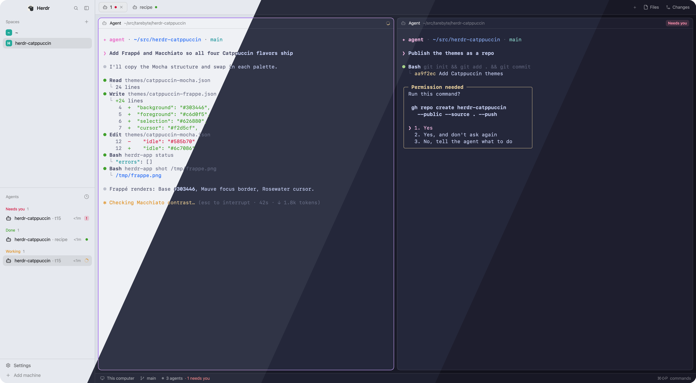

<h3 align="center">
  Catppuccin for <a href="https://herdr.dev">Herdr</a>
</h3>

<p align="center">
  
</p>

## Flavors

| Flavor | Theme name | Appearance |
|---|---|---|
| 🌻 Latte | `catppuccin-latte` | light |
| 🪴 Frappé | `catppuccin-frappe` | dark |
| 🌺 Macchiato | `catppuccin-macchiato` | dark |
| 🌿 Mocha | `catppuccin-mocha` | dark |

## Usage

### With your agent

Ask your coding agent:

```
Add the Herdr mod github.com/tarebyte/herdr-catppuccin
```

It follows [RECIPE.md](RECIPE.md) to install the themes and set them up.

### By hand

1. Download the themes into your Herdr home:
   ```sh
   for f in latte frappe macchiato mocha; do
     curl -fsSL --create-dirs -o ~/.config/herdr-app/themes/catppuccin-$f.json \
       https://raw.githubusercontent.com/tarebyte/herdr-catppuccin/main/themes/catppuccin-$f.json
   done
   ```
2. Pick a flavor in **Settings → Look**, or follow the system appearance by adding this to `~/.config/herdr-app/settings.json`:
   ```json
   "theme": { "light": "catppuccin-latte", "dark": "catppuccin-mocha" }
   ```
   Swap `catppuccin-mocha` for `catppuccin-frappe` or `catppuccin-macchiato` if you prefer.

### Notes

- `settings.json` applies only where a layout sets no theme of its own. Herdr's default layout sets none.
- A theme picked in Settings → Look overrides `settings.json` for that layout.

## Thanks

- [Catppuccin](https://catppuccin.com) for the palette.
- [catwalk](https://github.com/catppuccin/catwalk) for the preview.

## License

[MIT](LICENSE)
