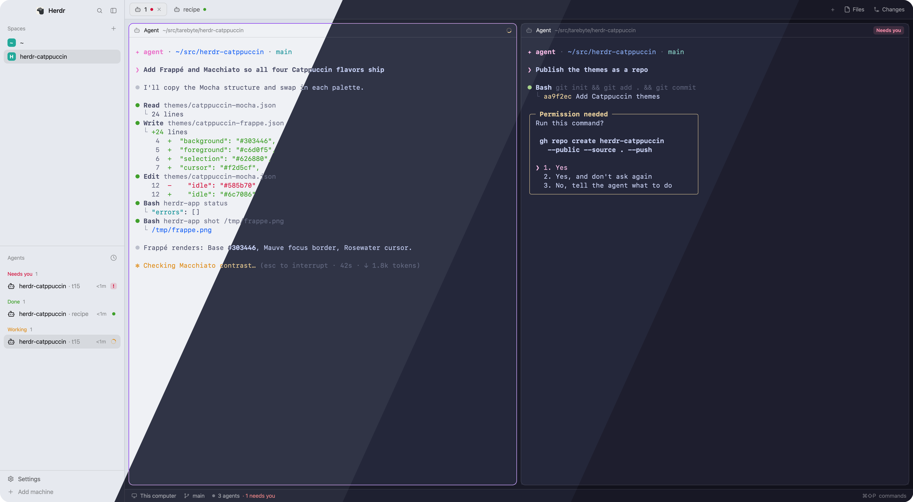

# Catppuccin

Catppuccin for the Herdr app: four themes, one per flavor. Latte is light; Frappé, Macchiato and Mocha are dark. Terminals, the sidebar and bars, the focus border and agent status colors all come from the Catppuccin palette. With the settings line below, Herdr shows Latte in light mode and Mocha in dark mode.



## What you see

The same parts in every flavor, from the edge in:

| Part | Theme key | Palette color | Latte | Frappé | Macchiato | Mocha |
|---|---|---|---|---|---|---|
| Behind cards | `colors.canvas` | Crust | `#dce0e8` | `#232634` | `#181926` | `#11111b` |
| Sidebar, tab bar, status bar | `colors.chrome` | Mantle | `#e6e9ef` | `#292c3c` | `#1e2030` | `#181825` |
| Terminal background | `background` | Base | `#eff1f5` | `#303446` | `#24273a` | `#1e1e2e` |
| Terminal text | `foreground` | Text | `#4c4f69` | `#c6d0f5` | `#cad3f5` | `#cdd6f4` |
| Selection | `selection` | Surface2 | `#acb0be` | `#626880` | `#5b6078` | `#585b70` |
| Cursor | `cursor` | Rosewater | `#dc8a78` | `#f2d5cf` | `#f4dbd6` | `#f5e0dc` |
| Focus border, accent | `colors.accent` | Mauve | `#8839ef` | `#ca9ee6` | `#c6a0f6` | `#cba6f7` |

ANSI colors (`ansi`, 16 entries, normal then bright):

| Index | Dark flavors | Latte |
|---|---|---|
| 0 / 8 | Surface1 / Surface2 | Subtext1 / Subtext0 |
| 1–6 and 9–14 | Red, Green, Yellow, Blue, Pink, Teal | same |
| 7 / 15 | Subtext1 / Subtext0 | Surface2 / Surface1 |

The bright colors 9–14 repeat the normal ones, as in the classic Catppuccin terminal ports.

| Flavor | Red | Green | Yellow | Blue | Pink | Teal | Surface1 | Surface2 | Subtext0 | Subtext1 |
|---|---|---|---|---|---|---|---|---|---|---|
| Latte | `#d20f39` | `#40a02b` | `#df8e1d` | `#1e66f5` | `#ea76cb` | `#179299` | `#bcc0cc` | `#acb0be` | `#6c6f85` | `#5c5f77` |
| Frappé | `#e78284` | `#a6d189` | `#e5c890` | `#8caaee` | `#f4b8e4` | `#81c8be` | `#51576d` | `#626880` | `#a5adce` | `#b5bfe2` |
| Macchiato | `#ed8796` | `#a6da95` | `#eed49f` | `#8aadf4` | `#f5bde6` | `#8bd5ca` | `#494d64` | `#5b6078` | `#a5adcb` | `#b8c0e0` |
| Mocha | `#f38ba8` | `#a6e3a1` | `#f9e2af` | `#89b4fa` | `#f5c2e7` | `#94e2d5` | `#45475a` | `#585b70` | `#a6adc8` | `#bac2de` |

## How it behaves

- Agent status colors: working is Yellow, blocked is Red, done is Green, idle is Overlay0 (Latte `#9ca0b0`, Frappé `#737994`, Macchiato `#6e738d`, Mocha `#6c7086`). They show in the Agents list, tab dots and pane headers.
- With `"theme": { "light": "catppuccin-latte", "dark": "catppuccin-mocha" }` in `settings.json`, the system appearance picks the flavor and it switches live.
- All four appear in Settings → Look by themselves: Latte under Light, the others under Dark.
- Herdr derives every other panel color (surface, raised, hover, border, muted, dim) from these values.

## Built from

- `themes/catppuccin-latte.json`, `themes/catppuccin-frappe.json`, `themes/catppuccin-macchiato.json`, `themes/catppuccin-mocha.json`. Each has `background`, `foreground`, `selection`, `cursor`, `ansi` (16) and `colors` with `accent`, `chrome`, `canvas`, `working`, `blocked`, `done`, `idle`, in that order.
- No mod code, no layout, no programs, no network access, no files read outside the theme folder.

### Install

1. Copy `themes/*.json` to `~/.config/herdr-app/themes/`. Never overwrite a file with the same name: rename the new one instead.
2. To follow the system appearance, add this key to `~/.config/herdr-app/settings.json` and keep every other key:
   ```json
   "theme": { "light": "catppuccin-latte", "dark": "catppuccin-mocha" }
   ```
   Ask the person before replacing a `theme` key they already have. Ask which dark flavor they want (Frappé, Macchiato or Mocha); use Mocha if they have no preference.
3. To use one flavor on the shown layout only: `herdr-app do app.theme --name catppuccin-<flavor>`.
4. Run `herdr-app status`, confirm `"errors": []`, and tell the person the themes are in Settings → Look.

## Watch out

- `settings.json` themes apply only where the layout sets no `theme`. Herdr (main) sets none; Terminals and Herdr 98 bring their own.
- A pick in Settings → Look (or `app.theme`) is stored per layout in `layouts/.state/` and overrides `settings.json` there. Don't test settings changes through the picker.
- Without `chrome` and `canvas`, Herdr's derived bar colors look neutral grey in Latte instead of Catppuccin blue-grey.
- Theme names are the file names. `catppuccin-frappe` has no accent in its name.

## Done when

- `herdr-app status` shows `"errors": []` and no `settings.error` exists.
- Settings → Look lists all four Catppuccin themes.
- In dark mode with the settings line, `herdr-app shot` shows a `#1e1e2e` terminal, `#181825` sidebar and a Mauve `#cba6f7` focus border.
- With `"appearance": "light"`, it shows a `#eff1f5` terminal and a `#e6e9ef` sidebar.
- An agent reporting `blocked` shows Red in the Agents list.
